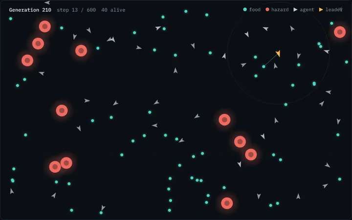
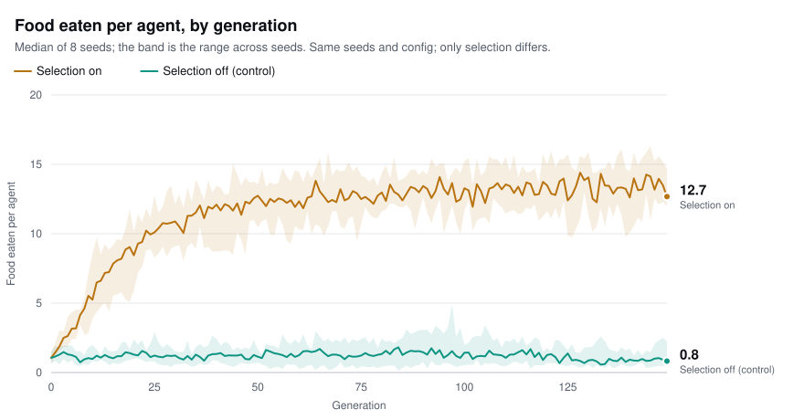

# neuronet-arena

[](https://github.com/brettadams0/neuronet-arena/actions/workflows/ci.yml)
[](LICENSE)

An evolution simulator. Forty agents share a 2D arena of food and hazards, each steered by its own
small neural network; after 600 steps the ones that ate the most become the parents of the next
generation. The network, the genetic algorithm and the random number generator are all written out
by hand — no NumPy, no PyTorch, no `random` — in Python, and again in JavaScript for a live demo
that reproduces the Python engine bit for bit.

**[Live demo](https://brettadams0.github.io/neuronet-arena/)** — runs in the browser, starting from
a population trained here in Python, and checks on screen that it scores exactly what Python
recorded.



## Does it actually evolve?

The first version of this project could not say. It also, it turned out, did not: `Simulation.run`
rebuilt the population from fresh random networks at the top of every generation, so the evolved
brains were thrown away unused — instrumenting it showed 0 of 20 surviving into the next
generation. Food was never consumed either, so an agent parked on one food node scored a point
every tick (300 in 300 ticks, without moving). Both are pinned by regression tests now.

So the rewrite measures it. `neuronet experiment` runs every seed twice with an identical config,
once normally and once with selection switched off — parents drawn uniformly at random, no elitism,
fitness computed but never read. Both start from the same population in the same world, so any gap
that opens is selection's doing.

<picture>
  <source media="(prefers-color-scheme: dark)" srcset="results/fitness-dark.svg">
  
</picture>

| 8 seeds × 150 generations | Selection on | Selection off |
|---|---:|---:|
| Food per agent, generation 0 | 1.07 | 1.07 |
| Food per agent, last 10 generations | **13.39** | **0.98** |
| &nbsp;&nbsp;range across seeds | 12.75 – 13.76 | 0.59 – 1.49 |
| Agents alive at the end, of 40 | 33.0 | 13.4 |
| Steps touching a hazard, per food eaten | 0.52 | 3.56 |

Evolved populations eat 13.7× as much, and mostly stay alive while doing it. The median passes ten
food per agent at generation 23 and plateaus a little above thirteen. Hazard avoidance comes along
without ever being rewarded directly: touching a hazard costs energy, energy is survival, and
survival is time to eat.

The raw per-generation data is in [`results/experiment.json`](results/experiment.json). Because the
simulation is deterministic, the same command reproduces it exactly:

```sh
neuronet experiment --seeds 8 --generations 150 --out results
```

## How it works

### Senses

Each step an agent builds eight inputs, all relative to its own heading, so the network does not
have to learn trigonometry before it can learn to forage:

| Input | |
|---|---|
| `food: near` | 1 at contact, 0 at the edge of vision (140 px); 0 if nothing is in sight |
| `food: ahead`, `food: right` | cosine and sine of the bearing to the nearest food |
| `hazard: near`, `hazard: ahead`, `hazard: right` | the same for the nearest hazard |
| `wall ahead` | how close the boundary is along the current heading |
| `energy` | remaining energy as a fraction of the maximum |

### Network

8 inputs → 10 hidden → 2 outputs, fully connected: 112 weights and biases, stored as one flat
list, which is the genome. Both layers use softsign, `x / (1 + |x|)`. The outputs are a steering
command and a throttle. ([`brain.py`](src/neuronet/brain.py))

### Body

Steering turns the agent by up to 11.4° a step; throttle sets speed up to 3 px a step. Energy
starts at 60 of a possible 100. Every step costs `0.08 + 0.02 × speed²`, each food restores 25
and respawns elsewhere, and every step spent touching a hazard costs 4. An agent at zero is out
for the rest of the generation. ([`agent.py`](src/neuronet/agent.py),
[`config.py`](src/neuronet/config.py))

### Evolution

Fitness is food eaten, with survival time breaking ties. The two best genomes are copied
unchanged; every other child comes from two tournament winners (best of three) by uniform
crossover 70% of the time, or a straight copy of one otherwise, and then each gene mutates with
probability 0.08 by 0.3 × a roughly normal sample. ([`evolution.py`](src/neuronet/evolution.py))

## Two engines, one set of bits

The demo could have been a lookalike: a JavaScript simulation that behaves *similarly*. Instead
the two engines are kept identical down to the last bit, and the test suites prove it.

That takes more than porting the logic. IEEE 754 requires `+ − × ÷` and `sqrt` to be correctly
rounded, so those agree everywhere; it does not require that of `tanh`, `exp`, `sin` or `cos`. On
200,000 random inputs in [−4, 4], CPython 3.13 (glibc) and Node 22 (V8) returned different doubles
for `tanh` 62 times, `sin` 6,690 times and `exp` 19,930 times. A generation makes up to 288,000
activation calls, and one flipped last bit is enough for a chaotic, 600-step simulation to become a
different run. So the hot path uses only the operations IEEE does pin down:

- **A shared PRNG.** xoshiro128\*\* seeded by splitmix32 ([`rng.py`](src/neuronet/rng.py),
  [`rng.js`](web/src/rng.js)), all 32-bit integer arithmetic. Normal samples come from an
  Irwin–Hall sum instead of Box–Muller, which needs `log` and `cos`.
- **Softsign instead of tanh.** Same shape, one add, one abs, one divide.
- **Turning without angles.** Heading is a unit vector, rotated by the Cayley transform —
  `cos θ = (1 − t²)/(1 + t²)`, `sin θ = 2t/(1 + t²)` — an exact rotation by `2·atan(t)` built from
  arithmetic alone, renormalised each step.
- **Fixed summation order.** Explicit loops instead of `sum()`, which since Python 3.12 uses
  compensated summation for floats and would no longer match a plain JavaScript loop.

[`fixtures/golden.json`](fixtures/golden.json) holds a trace written by the Python engine: RNG
output, a forward pass, and a four-generation run sampled every 20 steps, positions, headings,
energy and food included. [`tests/test_golden.py`](tests/test_golden.py) and
[`web/test/golden.test.js`](web/test/golden.test.js) both compare against it with exact equality.
Separately, the population the demo starts from was trained for 200 generations in Python and
saved with the stats Python scored on generation 200; the JavaScript tests, and the demo page
itself, replay that generation and check every number matches.

The payoff is speed where it is needed: a generation of the trained population takes about 0.7 s
in CPython and under 20 ms in V8, so the browser can fast-forward through dozens of generations a
second while Python stays the reference implementation.

## Running it

Python 3.10 or newer. The engine has no dependencies; the desktop viewer needs pygame.

```sh
pip install -e '.[viewer]'

neuronet view                                  # watch evolution from scratch
neuronet view --snapshot web/data/trained.json # watch the trained population
neuronet train --generations 200 --out runs/a  # headless: history.csv + snapshot.json
neuronet train --resume runs/a/snapshot.json --generations 50 --out runs/b
neuronet experiment --seeds 8 --generations 150 --out results
```

Any config field can be overridden with `--set`, e.g. `--set population=60 --set hazard_damage=8`,
or from a JSON file with `--config`. In the viewer: space pauses, up/down change speed, F finishes
the generation, Q quits.

The browser demo has no build step; serve the directory and open it:

```sh
cd web && python -m http.server   # http://localhost:8000
```

## Development

```sh
pip install -e '.[dev]'
pytest                  # includes the golden trace and a 30-generation learning test
ruff check . && ruff format --check . && mypy

cd web && npm ci
npm test                # node:test, including the same golden trace
npm run typecheck       # tsc --checkJs over the JSDoc types; nothing is emitted
```

If a change to the simulation is *meant* to change its output, regenerate the fixture and the
demo's population in the same commit:

```sh
python scripts/make_golden.py
neuronet train --seed 2026 --generations 200 --out runs/trained && cp runs/trained/snapshot.json web/data/trained.json
```

## Layout

```
src/neuronet/
  rng.py          xoshiro128** — the PRNG both engines share
  config.py       every tunable number, validated
  brain.py        the network and its genome layout
  world.py        food and hazard placement
  agent.py        senses, steering, energy
  evolution.py    elitism, tournament selection, crossover, mutation
  simulation.py   the generation loop; no rendering in it
  snapshot.py     save and resume a run between generations
  experiment.py   selection on vs off, across seeds, in parallel
  svgplot.py      the chart above, written as SVG by hand
  viewer.py       pygame viewer
  cli.py          neuronet train | view | experiment | plot
web/
  src/            the same engine in JavaScript, module for module
  ui/             the demo page: arena, network inspector, chart
  data/           the population trained in Python
fixtures/         the golden trace both test suites check
results/          the committed experiment and its charts
```

## License

MIT — see [LICENSE](LICENSE).
